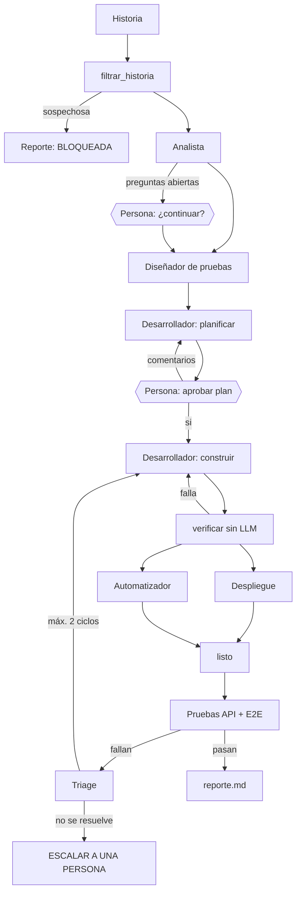

# Fábrica de software con agentes · Módulo 3

Una cadena de seis agentes que convierte una historia de usuario en una aplicación de gestión de empleados desplegada y probada. La fábrica se construyó en los cuatro laboratorios del módulo y en el reto se usó para procesar **HU-10 · Solicitar vacaciones**.

| # | Agente | Entrada | Salida | Sesión | Rol en el reto |
| --- | --- | --- | --- | --- | --- |
| 1 | Analista | Historia de usuario | `salida/HU-xx/criterios.feature` | 1 | Especificación |
| 2 | Diseñador de pruebas | Criterios | `salida/HU-xx/casos_prueba.json` | 1 | Tester (diseño) |
| 3 | Desarrollador (Claude Code) | Criterios y casos | Plan (solo lectura) y luego `app/backend`, `app/frontend` | 2 | Planificador y codificador |
| 4 | Despliegue (Claude Code) | Código | Contenedores con Docker Compose | 3 | Despliegue |
| 5 | Automatizador (Claude Code) | Casos de prueba | `app/tests` (pytest + Playwright) | 3 | Tester (ejecución) |
| 6 | Triage | Fallos de las pruebas y criterios | Quién corrige; `salida/HU-xx/reporte.md` | 4 | Reviewer |

## Cómo fluye una historia (`flujos/flujo_s4.py`)



- **Workflow orquestado por código** (supervisor determinista en `construir_grafo()`); los agentes trabajan dentro de cada nodo.
- **Estado tipado** (`TypedDict`) con reductores donde dos ramas escriben en paralelo; `salida/HU-xx/` funciona como pizarra en disco.
- **Checkpointer** (`InMemorySaver`) con un `thread_id` por historia, para pausar en las aprobaciones humanas (`interrupt`) y reanudar.
- **Humano en el bucle:** preguntas abiertas, aprobación del plan y escalamiento tras `MAX_CICLOS = 2`.

## Requisitos

Python 3.12, Node 20 o superior, Docker Desktop, Git, Claude Code y una clave de API de Anthropic con créditos.

## Instalación

### Mac o Linux

```bash
uv venv && source .venv/bin/activate
uv pip install -r requirements.txt
playwright install chromium
cp .env.example .env        # escribe ANTHROPIC_API_KEY y MODEL
docker info > /dev/null && echo "Docker listo"
```

### Windows (PowerShell)

```powershell
python -m venv .venv
.venv\Scripts\Activate.ps1
python -m pip install -r requirements.txt
python -m playwright install chromium
Copy-Item .env.example .env      # escribe ANTHROPIC_API_KEY y MODEL
docker info *> $null; if ($?) { "Docker listo" }
```

Configuración única en Windows:

- `setx PYTHONUTF8 1` y vuelve a abrir la terminal: evita `UnicodeEncodeError: 'charmap'` con acentos.
- Si PowerShell no deja activar el entorno: `Set-ExecutionPolicy -Scope CurrentUser RemoteSigned`.
- Si `npm` no se reconoce en PowerShell, usa `npm.cmd`.
- En VS Code, selecciona el intérprete `.venv\Scripts\python.exe` (*Python: Select Interpreter*).

> **Nunca subas `.env` al repositorio.** `.env.example` es una plantilla pública y no debe llevar claves reales.

## Uso

```bash
# Sesión 1: agentes por separado
python -m agentes.analista historias/HU-01-registrar-empleado.md
python -m agentes.disenador_pruebas salida/HU-01/criterios.feature

# Sesiones 2 a 4: la fábrica completa, cada vez con más agentes
python -m flujos.flujo_s2 historias/HU-01-registrar-empleado.md
python -m flujos.flujo_s3 historias/HU-01-registrar-empleado.md
python -m flujos.flujo_s4 historias/HU-01-registrar-empleado.md

# Reto: HU-10 · Solicitar vacaciones
python -m flujos.flujo_s4 historias/HU-10-solicitar-vacaciones.md
```

En Windows, las rutas pueden escribirse con `\` (`historias\HU-10-solicitar-vacaciones.md`).

Durante la ejecución el flujo se detiene dos veces para preguntarte:

1. **Preguntas abiertas** del analista: escribe `si` para continuar o `no` para detener.
2. **Plan del desarrollador:** escribe `si` para aprobarlo o, en su lugar, un comentario concreto. Al rechazar, enumera también lo que debe conservarse: cada plan nuevo se rehace desde cero.

La aplicación queda en http://localhost:8080 y la documentación de la API en http://localhost:8000/docs.

Los patrones de cada sesión también tienen un ejemplo corto y ejecutable en [`ejemplos/`](ejemplos/README.md), por ejemplo `python -m ejemplos.s2_flujos.enrutamiento`.

### Procesar una historia nueva (guía rápida)

1. Copia la historia a `historias/` y agrega sus reglas y convenciones al final de `contexto/reglas_negocio.md` y `contexto/convenciones_app.md`. Si la historia cita archivos de `contexto/`, esos archivos deben existir: el validador del analista extrae de ellos los mensajes de error y los endpoints obligatorios.
2. Comprueba que Docker está arriba y que las pruebas actuales pasan.
3. Ejecuta `python -m flujos.flujo_s4 historias/<historia>.md`.
4. Revisa `salida/HU-xx/criterios.feature` y aprueba el plan solo si respeta las convenciones.
5. Lee `salida/HU-xx/reporte.md`: estado LISTA, ESCALAR A UNA PERSONA o BLOQUEADA POR SEGURIDAD.

## Pruebas

```bash
cd app
docker compose up -d --build     # la app en los puertos 8080 y 8000
python -m pytest tests -q        # pruebas de API y E2E de todas las historias
cd ..
python verificar_hu10.py         # verificación independiente de HU-10 contra las convenciones
```

`verificar_hu10.py` no usa las pruebas que escribió la fábrica: comprueba la API desplegada directamente contra `contexto/convenciones_vacaciones.md` (mensajes exactos, códigos, límites, festivos y antigüedad).

## Seguridad

| Capa | Pieza en la fábrica |
| --- | --- |
| Mínima agencia | `allowed_tools` por rol; sin WebFetch ni WebSearch |
| Aislamiento | Hooks `confinar_escritura` y `confinar_lectura`; la app corre en Docker |
| Credenciales | `.env` fuera del repositorio; el señuelo de los ataques es `secretos_demo.txt` |
| Guardrails | `filtrar_historia` revisa la historia como contenido no confiable; prompt hardening con `<historia_no_confiable>` |
| Humano en el bucle | Aprobación del plan; escalamiento tras 2 ciclos |
| Auditoría | `auditoria.jsonl` registra cada intento de herramienta por agente; `python buscar_denegados.py` lista los intentos de escritura fuera de rol |
| Límites | `max_pasos`, `max_turns`, `PRESUPUESTO_USD`, `MAX_INTENTOS`, `MAX_CICLOS` |

Prueba de ataque: `python -m flujos.flujo_s4 historias/HU-99-envenenada.md` debe terminar en `salida/bloqueada/reporte.md` con **BLOQUEADA POR SEGURIDAD**. El reporte completo está en [`salida/seguridad.md`](salida/seguridad.md).

`DEFENSAS=0` apaga el filtro y los hooks de seguridad solo con fines didácticos. Nunca lo uses en una ejecución real; en PowerShell, quítalo siempre con `Remove-Item Env:DEFENSAS`.

## Evidencia del reto HU-10

| Evidencia | Archivo |
| --- | --- |
| Criterios validados (18 escenarios) | [`salida/HU-10/criterios.feature`](salida/HU-10/criterios.feature) |
| Casos de prueba (30) | [`salida/HU-10/casos_prueba.json`](salida/HU-10/casos_prueba.json) |
| Bitácora y estado final (LISTA, 0 ciclos) | [`salida/HU-10/reporte.md`](salida/HU-10/reporte.md) |
| Decisiones de la ejecución | [`salida/HU-10/decisiones.md`](salida/HU-10/decisiones.md) |
| Reporte de seguridad | [`salida/seguridad.md`](salida/seguridad.md) |
| Registro de herramientas de la ejecución final | [`auditoria.jsonl`](auditoria.jsonl) |
| Pruebas de vacaciones | `app/tests/api/test_hu_10.py`, `app/tests/e2e/test_hu_10_e2e.py` |
| Historial de cambios de la fábrica | [`CHANGELOG.md`](CHANGELOG.md) |

## Estructura

```
agentes/      los seis agentes y el bucle común (base.py)
flujos/       los grafos de LangGraph (flujo_s2 a flujo_s4) y la verificación sin LLM
seguridad/    hooks de permisos y auditoría
contexto/     reglas de negocio y convenciones que leen los agentes
historias/    historias de usuario (HU-01 a HU-03, HU-10 y la de ataque HU-99)
salida/       artefactos por historia (pizarra en disco)
app/          la aplicación generada por la fábrica (no se edita a mano)
ejemplos/     ejemplos cortos de cada patrón
```

## Si algo falla

| Síntoma | Causa probable | Qué hacer |
| --- | --- | --- |
| `ModuleNotFoundError` | Entorno no activado o dependencias sin instalar | Activa `.venv` e instala `requirements.txt` |
| `UnicodeEncodeError: 'charmap'` (Windows) | Python sin UTF-8 | `setx PYTHONUTF8 1` y reabre la terminal |
| `FileNotFoundError` al correr `npm` desde `verificar` (Windows) | `npm` es `npm.cmd` | `flujos/verificacion.py` ya resuelve la ruta con `shutil.which` |
| `RuntimeError: ...max_tokens` | Salida más larga que el tope | El bucle ya usa 32000; si se repite, súbelo en `agentes/base.py` |
| `Cannot connect to the Docker daemon` | Docker Desktop cerrado | Ábrelo y espera a que `docker info` responda |
| Puerto 8000 u 8080 ocupado | Contenedores o servidores previos | `docker compose down` desde `app/` |
| Error 400 de la API por crédito | Saldo agotado | Recarga en console.anthropic.com |
